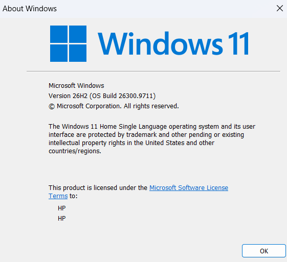
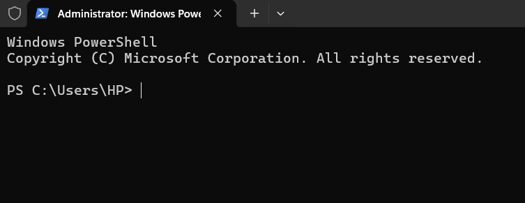
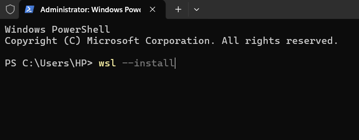
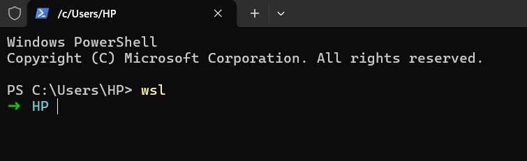
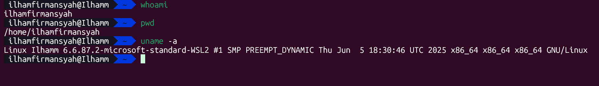
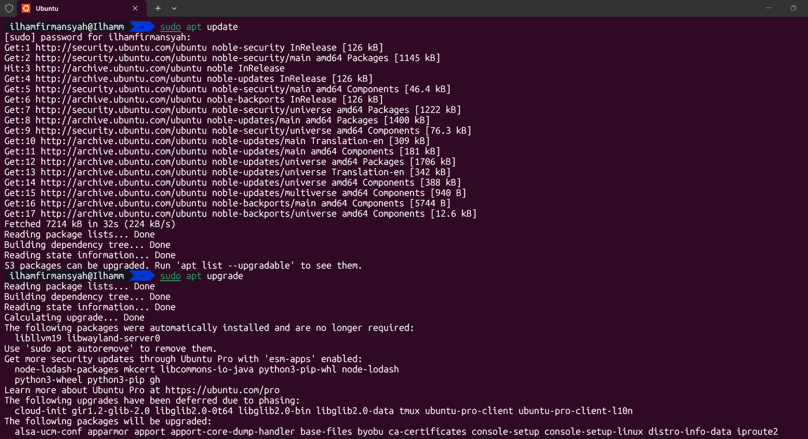

# Panduan Instalasi Linux di Windows Menggunakan WSL 2

Panduan lengkap untuk menginstal dan menjalankan Ubuntu Linux di Windows menggunakan Windows Subsystem for Linux (WSL) 2. Dokumentasi ini ditujukan bagi pemula yang belum pernah menggunakan Linux dan ingin mempelajari perintah dasar Linux tanpa harus mengganti sistem operasi Windows.

---

## Daftar Isi

1. [Pendahuluan](#1-pendahuluan)
2. [Apa Itu Linux?](#2-apa-itu-linux)
3. [Apa Itu WSL?](#3-apa-itu-wsl)
4. [Apa Itu WSL 2?](#4-apa-itu-wsl-2)
5. [Mengapa Menggunakan WSL?](#5-mengapa-menggunakan-wsl)
6. [Persiapan Instalasi](#6-persiapan-instalasi)
7. [Memeriksa Versi Windows](#7-memeriksa-versi-windows)
8. [Membuka PowerShell sebagai Administrator](#8-membuka-powershell-sebagai-administrator)
9. [Menginstal WSL dan Ubuntu](#9-menginstal-wsl-dan-ubuntu)
10. [Restart Windows](#10-restart-windows)
11. [Konfigurasi Awal Ubuntu](#11-konfigurasi-awal-ubuntu)
12. [Menjalankan Ubuntu](#12-menjalankan-ubuntu)
13. [Verifikasi Instalasi](#13-verifikasi-instalasi)
14. [Memperbarui Paket Ubuntu](#14-memperbarui-paket-ubuntu)
15. [Mengenal Perintah Dasar Linux](#15-mengenal-perintah-dasar-linux)
16. [Mengakses File Windows dari Linux](#16-mengakses-file-windows-dari-linux)
17. [Perintah Dasar WSL](#17-perintah-dasar-wsl)
18. [Troubleshooting](#18-troubleshooting)
19. [Kesimpulan](#19-kesimpulan)
20. [Referensi](#20-referensi)

---

## 1. Pendahuluan

Linux merupakan sistem operasi yang banyak digunakan dalam pengembangan perangkat lunak, administrasi server, komputasi awan, dan berbagai bidang teknologi informasi.

Dalam pembelajaran pemrograman, beberapa alat dan lingkungan pengembangan menggunakan perintah Linux. Namun, pengguna Windows tidak harus mengganti sistem operasi atau memasang dual boot hanya untuk mempelajari perintah-perintah tersebut.

Microsoft menyediakan fitur bernama **Windows Subsystem for Linux (WSL)** yang memungkinkan pengguna menjalankan lingkungan Linux secara langsung di Windows.

Melalui panduan ini, pengguna akan mempelajari cara memasang WSL 2 dan Ubuntu, melakukan konfigurasi awal, memeriksa hasil instalasi, serta mencoba beberapa perintah dasar Linux.

### Tujuan

Setelah mengikuti panduan ini, pengguna diharapkan mampu:

- Memahami konsep Linux, WSL, dan WSL 2.
- Menginstal WSL dan Ubuntu pada Windows.
- Membuat akun pengguna Linux.
- Memeriksa status dan versi distribusi Linux.
- Menjalankan perintah dasar Linux.
- Memperbarui paket Ubuntu.
- Memahami solusi awal untuk masalah instalasi yang umum terjadi.

---

## 2. Apa Itu Linux?

Linux adalah keluarga sistem operasi yang menggunakan kernel Linux. Kernel merupakan bagian inti sistem operasi yang mengelola sumber daya komputer, seperti prosesor, memori, perangkat keras, dan proses yang sedang berjalan.

Dalam penggunaan sehari-hari, istilah Linux juga sering digunakan untuk menyebut distribusi Linux, yaitu sistem operasi yang menggabungkan kernel Linux dengan berbagai perangkat lunak dan utilitas.

Beberapa distribusi Linux yang populer antara lain:

| Distribusi | Keterangan |
|---|---|
| Ubuntu | Banyak digunakan untuk pembelajaran, pengembangan perangkat lunak, dan server. |
| Debian | Dikenal sebagai distribusi dengan pendekatan stabilitas dan pengelolaan paket yang kuat. |
| Fedora | Menyediakan teknologi Linux yang relatif mutakhir. |
| Kali Linux | Berfokus pada pengujian keamanan dan pembelajaran keamanan siber yang berizin. |

Pada panduan ini, distribusi yang digunakan adalah **Ubuntu** karena sesuai untuk pemula dan didukung oleh WSL.

---

## 3. Apa Itu WSL?

**Windows Subsystem for Linux (WSL)** adalah fitur Windows yang memungkinkan pengguna menjalankan lingkungan Linux di dalam Windows tanpa harus mengganti sistem operasi utama.

Dengan WSL, pengguna dapat menjalankan shell Linux, utilitas baris perintah, serta berbagai alat pengembangan yang tersedia untuk Linux.

Contoh pemanfaatan WSL:

- Belajar perintah dasar Linux.
- Menjalankan compiler dan alat pemrograman.
- Menggunakan Git dan berbagai utilitas pengembangan.
- Mempelajari lingkungan server dan administrasi sistem.
- Menjalankan berbagai workflow pengembangan berbasis Linux.

WSL bukan sekadar terminal dengan tampilan berbeda. WSL menyediakan lingkungan Linux yang dapat menjalankan program Linux sesuai dukungan dan konfigurasi sistemnya.

---

## 4. Apa Itu WSL 2?

WSL memiliki dua versi utama, yaitu WSL 1 dan WSL 2.

WSL 1 menggunakan lapisan kompatibilitas untuk menjalankan program Linux, sedangkan WSL 2 menggunakan kernel Linux asli yang berjalan melalui lingkungan virtualisasi ringan.

Beberapa perbedaannya:

| Aspek | WSL 1 | WSL 2 |
|---|---|---|
| Kernel Linux asli | Tidak | Ya |
| Arsitektur | Lapisan kompatibilitas | Mesin virtual ringan |
| Kompatibilitas sistem Linux | Baik untuk banyak utilitas | Lebih lengkap untuk kompatibilitas sistem Linux |
| Kebutuhan virtualisasi | Tidak menggunakan VM untuk menjalankan kernel Linux | Memerlukan dukungan virtualisasi |
| Cocok untuk | Kebutuhan tertentu yang sesuai dengan WSL 1 | Penggunaan Linux umum dan pengembangan modern |

**Rekomendasi:** gunakan WSL 2 untuk mengikuti panduan ini.

WSL 2 memungkinkan pengguna menjalankan lingkungan Linux yang lebih kompatibel dengan sistem Linux pada umumnya. Meskipun menggunakan teknologi virtualisasi, pengguna tidak perlu membuat dan mengonfigurasi mesin virtual secara manual seperti pada pendekatan virtualisasi tradisional.

---

## 5. Mengapa Menggunakan WSL?

WSL memiliki beberapa kelebihan untuk pembelajaran dan pengembangan perangkat lunak.

1. **Tidak perlu mengganti sistem operasi.** Windows tetap menjadi sistem operasi utama.
2. **Tidak perlu dual boot.** Windows dan lingkungan Linux dapat digunakan pada komputer yang sama tanpa memilih sistem operasi saat startup.
3. **Mendukung pembelajaran terminal Linux.** Pengguna dapat mempraktikkan perintah Linux langsung dari Ubuntu.
4. **Mendukung berbagai alat pengembangan.** Banyak compiler, package manager, dan utilitas pengembangan tersedia di lingkungan Linux.
5. **Terintegrasi dengan Windows.** File Windows dapat diakses dari Linux, dan program Windows tertentu dapat dipanggil dari lingkungan Linux.
6. **Cocok untuk pemula.** Instalasi dasar dapat dilakukan melalui satu perintah pada versi Windows yang didukung.

Perlu diperhatikan bahwa WSL tidak berarti semua aplikasi Linux dengan antarmuka grafis atau semua perangkat keras Linux otomatis didukung. Dukungan bergantung pada aplikasi dan konfigurasi yang digunakan.

---

## 6. Persiapan Instalasi

Sebelum memulai, siapkan hal-hal berikut:

- Komputer dengan Windows 11 atau Windows 10 versi yang mendukung instalasi WSL modern.
- Koneksi internet untuk mengunduh komponen WSL dan Ubuntu.
- Akun Windows yang memiliki hak Administrator.
- Ruang penyimpanan yang cukup.
- Dukungan virtualisasi perangkat keras untuk WSL 2.

### Catatan penting

Proses instalasi dapat meminta komputer melakukan restart. Simpan pekerjaan yang sedang dikerjakan sebelum memulai.

Panduan utama ini menggunakan Windows 11 dan instalasi Ubuntu sebagai distribusi Linux default.

---

## 7. Memeriksa Versi Windows

Sebelum memasang WSL, periksa versi Windows yang digunakan.

### Langkah 1 — Membuka jendela Run

Tekan kombinasi tombol berikut:

`Windows + R`

Jendela Run akan muncul.

### Langkah 2 — Menjalankan perintah winver

Ketik perintah berikut:

```text
winver
```

Tekan Enter.

Jendela About Windows akan menampilkan informasi edisi, versi, dan OS Build Windows.

### Langkah 3 — Memeriksa informasi Windows

Pastikan sistem menggunakan Windows 11 atau versi Windows 10 yang didukung oleh metode instalasi ini.

Jika menggunakan Windows 10 versi lama, periksa persyaratan pada dokumentasi resmi Microsoft karena langkah instalasinya mungkin berbeda.

**Screenshot yang perlu disimpan:**

Simpan gambar jendela About Windows dengan nama:

`screenshots/01-cek-versi-windows.png`



---

## 8. Membuka PowerShell sebagai Administrator

WSL perlu diinstal menggunakan terminal dengan hak Administrator agar Windows dapat mengaktifkan komponen sistem yang diperlukan.

### Langkah 1 — Membuka menu Start

Klik tombol Start pada taskbar Windows.

### Langkah 2 — Mencari terminal

Ketik salah satu nama berikut:

- Windows Terminal
- PowerShell

### Langkah 3 — Menjalankan sebagai Administrator

Klik kanan aplikasi yang dipilih, kemudian klik **Run as administrator**.

Jika Windows menampilkan konfirmasi User Account Control (UAC), periksa permintaannya lalu pilih Yes untuk melanjutkan.

### Langkah 4 — Memastikan terminal terbuka

Jendela terminal akan terbuka dengan hak Administrator.

Pada Windows Terminal, judul tab atau jendela biasanya menunjukkan bahwa terminal berjalan sebagai Administrator.



---

## 9. Menginstal WSL dan Ubuntu

Pada Windows yang mendukung perintah instalasi modern, WSL dapat dipasang menggunakan satu perintah.

### Langkah 1 — Menjalankan perintah instalasi

Di PowerShell atau Windows Terminal yang berjalan sebagai Administrator, ketik:

```powershell
wsl --install
```

Tekan **Enter**.

Perintah tersebut akan mengaktifkan komponen yang diperlukan untuk WSL dan memasang distribusi Ubuntu sebagai distribusi default.



### Langkah 2 — Menunggu proses instalasi

Tunggu sampai proses pengunduhan dan instalasi selesai.

Waktu yang diperlukan bergantung pada ***koneksi internet, kinerja komputer, dan kondisi Windows***.

Jangan menutup terminal secara paksa ketika proses instalasi masih berjalan.

**Screenshot yang perlu disimpan:**

Simpan gambar yang menunjukkan proses pengunduhan atau instalasi dengan nama:

`screenshots/04-proses-instalasi-wsl.png`


### Langkah 3 — Memahami hasil perintah

Jika proses berhasil, Windows mungkin meminta pengguna untuk melakukan restart.

Jika perintah tidak berjalan sebagaimana mestinya, jangan langsung mengulangi instalasi berkali-kali. Periksa pesan yang ditampilkan dan lihat bagian Troubleshooting.

**Catatan:** perintah `wsl --install` ditujukan untuk skenario instalasi awal. Jika WSL sudah terpasang tetapi distribusi Linux belum tersedia, gunakan pemeriksaan dan perintah instalasi distribusi yang dijelaskan pada bagian Troubleshooting.

---

## 10. Restart Windows

Pada beberapa komputer, restart diperlukan agar perubahan komponen Windows dapat diterapkan.

### Langkah 1 — Menyimpan pekerjaan

Simpan semua dokumen dan pekerjaan yang sedang terbuka.

### Langkah 2 — Melakukan restart

Jika proses instalasi meminta restart, pilih Restart pada petunjuk yang tersedia atau lakukan restart melalui menu Windows.

### Langkah 3 — Menunggu Windows kembali menyala

Setelah restart selesai, masuk kembali ke akun Windows.

Jika instalasi meminta tindakan tambahan, ikuti petunjuk yang muncul di layar.

**Screenshot yang perlu disimpan:**

Jika muncul pesan yang meminta restart, simpan gambar pesan tersebut dengan nama:

`screenshots/05-restart-windows.png`


Jika tidak ada pesan restart yang muncul, bagian ini tetap dapat dijelaskan tanpa screenshot. Jangan membuat screenshot simulasi yang seolah-olah berasal dari proses instalasi asli.

---

## 11. Konfigurasi Awal Ubuntu

Setelah instalasi selesai, Ubuntu mungkin terbuka secara otomatis. Jika tidak, buka menu Start dan cari Ubuntu.

Pada peluncuran pertama, Ubuntu menyiapkan berkas sistem dan meminta pengguna membuat akun Linux.

### Langkah 1 — Menunggu inisialisasi Ubuntu

Tunggu sampai proses persiapan distribusi selesai.

Proses pertama kali dapat memerlukan waktu lebih lama daripada peluncuran berikutnya.

### Langkah 2 — Membuat username

Ubuntu akan meminta nama pengguna UNIX.

Masukkan username yang ingin digunakan, kemudian tekan Enter.

Gunakan nama yang sederhana dan ikuti aturan karakter yang diterima oleh Ubuntu.

Username Linux ini merupakan akun di dalam Ubuntu dan tidak harus sama dengan nama akun Windows.

### Langkah 3 — Membuat password

Masukkan password untuk akun Linux, kemudian tekan Enter.

Saat mengetik password, karakter biasanya tidak akan ditampilkan di terminal. Tidak munculnya karakter bukan berarti keyboard tidak berfungsi.

Ketik password dengan hati-hati, lalu masukkan kembali apabila diminta.

**Penting:** password yang dibuat di tahap ini adalah password akun Linux, bukan otomatis password akun Windows.

### Langkah 4 — Menyelesaikan konfigurasi

Jika konfigurasi berhasil, Ubuntu akan menampilkan prompt terminal yang memungkinkan pengguna memasukkan perintah Linux.

**Screenshot yang perlu disimpan:**

Simpan screenshot proses pembuatan username atau tampilan awal Ubuntu dengan nama:

`screenshots/06-konfigurasi-ubuntu.png`


Jangan menampilkan password asli dalam screenshot atau dokumentasi.

---

## 12. Menjalankan Ubuntu

Setelah konfigurasi awal selesai, Ubuntu dapat dibuka kapan saja dari menu Start.

### Cara pertama — Melalui menu Start

1. Klik Start.
2. Cari Ubuntu.
3. Buka aplikasi Ubuntu.
4. Tunggu sampai terminal siap digunakan.

### Cara kedua — Melalui Windows Terminal

Buka Windows Terminal, kemudian pilih profil Ubuntu jika tersedia.

### Cara ketiga — Melalui PowerShell

Jalankan perintah:

```powershell
wsl
```

Perintah tersebut membuka distribusi Linux default yang sudah terpasang.

Jika Ubuntu adalah distribusi default, terminal akan masuk ke lingkungan Ubuntu.

**Screenshot yang perlu disimpan:**

Simpan gambar terminal Ubuntu yang berhasil dibuka dengan nama:

`screenshots/07-terminal-ubuntu.png`



---

## 13. Verifikasi Instalasi

Tahap ini digunakan untuk memastikan bahwa Ubuntu sudah terpasang dan dapat digunakan.

### Langkah 1 — Memeriksa distribusi dan versi WSL

Di PowerShell atau Windows Terminal yang sedang menjalankan PowerShell, ketik:

```powershell
wsl --list --verbose
```

Contoh keluaran:

```text
  NAME      STATE      VERSION
* Ubuntu    Running    2
```

Keterangan:

- `NAME`: nama distribusi Linux.
- `STATE`: status distribusi, misalnya Running atau Stopped.
- `VERSION`: versi WSL yang digunakan oleh distribusi tersebut.
- Tanda `*`: menunjukkan distribusi default.

Hasil yang sebenarnya dapat berbeda sesuai kondisi komputer.

Jika Ubuntu menunjukkan `VERSION 2`, distribusi tersebut berjalan menggunakan WSL 2.

Jika statusnya `Stopped`, hal itu tidak otomatis berarti instalasi gagal. Distribusi dapat berada dalam keadaan tersebut ketika tidak sedang digunakan.

### Langkah 2 — Memeriksa informasi WSL

Jalankan:

```powershell
wsl --status
```

Perintah ini menampilkan informasi status dan konfigurasi WSL yang tersedia pada sistem.

### Langkah 3 — Menguji perintah Linux

Masuk ke terminal Ubuntu, kemudian jalankan:

```bash
whoami
pwd
uname -a
```

Penjelasan:

| Perintah | Fungsi |
|---|---|
| `whoami` | Menampilkan username Linux yang sedang digunakan. |
| `pwd` | Menampilkan lokasi direktori kerja saat ini. |
| `uname -a` | Menampilkan informasi kernel dan sistem. |

Jika ketiga perintah berhasil dijalankan, lingkungan Ubuntu dapat digunakan untuk praktik Linux dasar.

**Screenshot yang perlu disimpan:**

Simpan screenshot yang memperlihatkan hasil pemeriksaan WSL dan perintah Linux dengan nama:

`screenshots/08-verifikasi-wsl.png`



---

## 14. Memperbarui Paket Ubuntu

Setelah Ubuntu dapat digunakan, sebaiknya perbarui informasi paket dan paket yang terpasang.

Pastikan perintah berikut dijalankan di **terminal Ubuntu**, bukan di PowerShell.

### Langkah 1 — Memperbarui daftar paket

Jalankan:

```bash
sudo apt update
```

Perintah ini mengambil informasi paket terbaru dari repositori yang dikonfigurasi.

### Langkah 2 — Memperbarui paket yang terpasang

Jalankan:

```bash
sudo apt upgrade
```

Perintah tersebut memeriksa dan menawarkan pembaruan untuk paket yang terpasang.

Jika diminta konfirmasi, baca informasi yang ditampilkan sebelum melanjutkan.

Perintah `sudo` menjalankan perintah dengan hak administratif di lingkungan Linux. Ubuntu mungkin meminta password akun Linux yang dibuat pada tahap konfigurasi awal.

### Alternatif — Menjalankan kedua perintah

Kedua perintah dapat digabungkan:

```bash
sudo apt update && sudo apt upgrade
```

Operator `&&` membuat perintah kedua dijalankan apabila perintah pertama berhasil.

**Screenshot yang perlu disimpan:**

Simpan gambar hasil pembaruan paket dengan nama:

`screenshots/09-update-ubuntu.png`



---

## 15. Mengenal Perintah Dasar Linux

Berikut beberapa perintah dasar yang dapat dipraktikkan setelah instalasi berhasil.

### 15.1. Menampilkan direktori saat ini

```bash
pwd
```

Perintah `pwd` merupakan singkatan dari *print working directory*. Perintah ini menampilkan direktori tempat pengguna sedang berada.

### 15.2. Melihat isi direktori

```bash
ls
```

Untuk melihat informasi lebih lengkap:

```bash
ls -la
```

Perintah tersebut menampilkan daftar berkas dan direktori, termasuk berkas tersembunyi.

### 15.3. Berpindah direktori

```bash
cd /
```

Perintah ini berpindah ke direktori root Linux.

Untuk kembali ke direktori home pengguna:

```bash
cd ~
```

### 15.4. Membuat direktori

```bash
mkdir latihan-linux
```

Perintah `mkdir` digunakan untuk membuat direktori baru bernama `latihan-linux`.

### 15.5. Masuk ke direktori latihan

```bash
cd latihan-linux
```

### 15.6. Membuat berkas kosong

```bash
touch catatan.txt
```

Perintah `touch` dapat digunakan untuk membuat berkas kosong jika berkas tersebut belum ada.

### 15.7. Melihat isi berkas

```bash
cat catatan.txt
```

Perintah `cat` menampilkan isi berkas pada terminal. Karena berkas latihan masih kosong, tidak ada teks yang ditampilkan.

### 15.8. Menghapus berkas latihan

```bash
rm catatan.txt
```

Perintah ini menghapus berkas `catatan.txt`. Gunakan dengan hati-hati karena penghapusan melalui terminal dapat sulit dibatalkan.

### 15.9. Kembali ke direktori sebelumnya

```bash
cd ..
```

Perintah ini berpindah ke direktori induk dari lokasi saat ini.

### 15.10. Melihat identitas pengguna

```bash
whoami
```

Perintah ini menampilkan username Linux yang sedang aktif.

### Ringkasan perintah

| Perintah | Fungsi |
|---|---|
| `pwd` | Menampilkan direktori saat ini |
| `ls` | Menampilkan isi direktori |
| `ls -la` | Menampilkan daftar terperinci termasuk berkas tersembunyi |
| `cd` | Berpindah direktori |
| `mkdir` | Membuat direktori |
| `touch` | Membuat berkas kosong |
| `cat` | Menampilkan isi berkas |
| `rm` | Menghapus berkas |
| `whoami` | Menampilkan username |
| `sudo` | Menjalankan perintah dengan hak administratif |
| `apt` | Mengelola paket pada Ubuntu dan distribusi berbasis Debian |

**Screenshot yang perlu disimpan:**

Simpan screenshot ketika beberapa perintah dasar berhasil dijalankan dengan nama:

`screenshots/10-praktik-perintah-linux.png`


---

## 16. Mengakses File Windows dari Linux

Salah satu kelebihan WSL adalah integrasi dengan sistem berkas Windows.

Drive Windows umumnya tersedia melalui direktori `/mnt`.

Sebagai contoh, drive C: biasanya dapat diakses melalui:

```bash
cd /mnt/c
```

Untuk melihat isi direktori tersebut:

```bash
ls
```

Jika ingin masuk ke direktori pengguna Windows, jalurnya dapat berbentuk:

```bash
cd /mnt/c/Users
```

Nama dan struktur direktori dapat berbeda sesuai konfigurasi komputer.

### Catatan penggunaan berkas

Untuk proyek pengembangan yang menggunakan alat Linux, Microsoft umumnya merekomendasikan penyimpanan proyek di sistem berkas Linux, misalnya di dalam direktori home Ubuntu.

Contoh:

```bash
cd ~
mkdir proyek
cd proyek
```

Pendekatan ini dapat memberikan kinerja yang lebih baik untuk banyak workflow Linux dibandingkan menjalankan operasi berkas secara intensif pada direktori yang dipasang dari sistem berkas Windows.

---

## 17. Perintah Dasar WSL

Perintah berikut dijalankan dari PowerShell atau Command Prompt Windows, kecuali jika dijelaskan sebaliknya.

### 17.1. Memeriksa distribusi yang terpasang

```powershell
wsl --list --verbose
```

Menampilkan nama distribusi, status, dan versi WSL masing-masing.

### 17.2. Memeriksa status WSL

```powershell
wsl --status
```

Menampilkan informasi konfigurasi WSL yang tersedia.

### 17.3. Menjalankan Ubuntu

```powershell
wsl --distribution Ubuntu
```

Menjalankan distribusi bernama Ubuntu.

### 17.4. Mengakhiri sesi Linux

Di dalam terminal Linux, jalankan:

```bash
exit
```

Perintah ini mengakhiri sesi shell saat ini.

### 17.5. Mematikan seluruh distribusi WSL yang sedang berjalan

```powershell
wsl --shutdown
```

Perintah ini menghentikan seluruh distribusi WSL yang sedang berjalan dan mesin virtual ringan WSL 2 yang terkait.

Gunakan jika memang diperlukan, misalnya untuk menerapkan perubahan konfigurasi atau mengatasi kondisi tertentu.

### 17.6. Memperbarui WSL

```powershell
wsl --update
```

Perintah ini memeriksa dan memasang pembaruan WSL yang tersedia.

### 17.7. Melihat distribusi yang tersedia

```powershell
wsl --list --online
```

Menampilkan daftar distribusi Linux yang tersedia untuk instalasi melalui mekanisme WSL.

### 17.8. Menginstal Ubuntu secara spesifik

Jika WSL sudah terpasang tetapi Ubuntu belum terinstal, gunakan:

```powershell
wsl --install -d Ubuntu
```

Perintah ini ditujukan untuk memasang distribusi Ubuntu. Jika Ubuntu sudah terpasang, periksa terlebih dahulu hasil `wsl --list --verbose` agar tidak melakukan instalasi yang tidak diperlukan.

---

## 18. Troubleshooting

Bagian ini menjelaskan beberapa masalah umum yang mungkin muncul saat memasang atau menjalankan WSL.

### 18.1. Perintah `wsl --install` tidak berjalan sesuai harapan

Jika terminal hanya menampilkan bantuan perintah atau Ubuntu belum terpasang, periksa daftar distribusi yang tersedia:

```powershell
wsl --list --online
```

Kemudian, jika WSL sudah ada tetapi Ubuntu belum terpasang, jalankan:

```powershell
wsl --install -d Ubuntu
```

Perhatikan pesan yang muncul untuk mengetahui tahap yang belum selesai.

### 18.2. Instalasi meminta restart

Simpan pekerjaan yang sedang berjalan, kemudian restart Windows jika diminta.

Setelah komputer menyala kembali, buka Ubuntu melalui menu Start atau ikuti petunjuk lanjutan yang muncul.

### 18.3. Muncul pesan bahwa virtualisasi diperlukan

WSL 2 memerlukan dukungan virtualisasi perangkat keras.

Jika pesan terkait virtualisasi muncul:

1. Pastikan perangkat keras komputer mendukung virtualisasi.
2. Periksa apakah virtualisasi diaktifkan pada firmware BIOS/UEFI.
3. Pastikan fitur Windows yang diperlukan oleh WSL 2 tersedia.
4. Jika perlu, minta bantuan administrator perangkat untuk mengubah konfigurasi sistem.

Langkah yang tepat dapat berbeda tergantung perangkat dan versi Windows.

### 18.4. Ubuntu tidak terbuka

Buka PowerShell dan periksa:

```powershell
wsl --list --verbose
```

Jika Ubuntu tidak muncul dalam daftar, distribusi tersebut mungkin belum terpasang.

Jika Ubuntu muncul tetapi gagal dijalankan, catat pesan error yang ditampilkan dan periksa dokumentasi troubleshooting resmi WSL.

### 18.5. Password Linux tidak terlihat saat diketik

Ini merupakan perilaku normal pada prompt password Linux. Terminal biasanya tidak menampilkan karakter maupun tanda bintang saat password dimasukkan.

Ketik password dengan hati-hati, lalu tekan Enter.

### 18.6. Perintah `sudo apt update` gagal

Pastikan:

- Ubuntu memiliki koneksi jaringan yang berfungsi.
- Perintah dijalankan di terminal Ubuntu, bukan PowerShell.
- Repositori paket dapat diakses.
- Pesan error tidak menunjukkan masalah DNS, koneksi, atau konfigurasi repositori.

Jika masalah berlanjut, catat pesan error lengkap sebelum melakukan perubahan konfigurasi.

### 18.7. Distribusi menunjukkan status `Stopped`

Status `Stopped` tidak selalu menunjukkan kegagalan.

Distribusi dapat berhenti ketika tidak sedang digunakan. Jalankan Ubuntu kembali, kemudian periksa statusnya menggunakan:

```powershell
wsl --list --verbose
```

### 18.8. Instalasi macet pada proses pengunduhan

Periksa koneksi internet dan tunggu beberapa saat. Jika instalasi tetap macet pada tahap pengunduhan, dokumentasi Microsoft menyediakan alternatif pengunduhan web untuk distribusi tertentu.

Contoh perintah yang dapat dicoba jika sesuai dengan pesan error:

```powershell
wsl --install --web-download -d Ubuntu
```

Periksa status instalasi terlebih dahulu agar tidak mengulangi proses tanpa mengetahui penyebabnya.

---

## 19. Kesimpulan

Windows Subsystem for Linux (WSL) memungkinkan pengguna Windows menjalankan lingkungan Linux tanpa harus mengganti sistem operasi utama atau membuat konfigurasi dual boot.

Dengan memasang WSL 2 dan Ubuntu, pengguna dapat mempelajari perintah Linux, mengelola paket, menjalankan berbagai alat pengembangan, serta memahami lingkungan kerja yang banyak digunakan dalam pengembangan perangkat lunak.

Tahapan utama dalam panduan ini meliputi:

1. Memeriksa versi Windows.
2. Membuka PowerShell sebagai Administrator.
3. Menjalankan perintah instalasi WSL.
4. Menyelesaikan konfigurasi awal Ubuntu.
5. Memverifikasi instalasi.
6. Memperbarui paket dan mencoba perintah dasar Linux.

Setelah menyelesaikan panduan, pengguna dapat melanjutkan pembelajaran Linux, Git, pemrograman, dan pengembangan perangkat lunak menggunakan lingkungan WSL.

---

## 20. Referensi

1. Microsoft Learn — Menginstal WSL: https://learn.microsoft.com/id-id/windows/wsl/install
2. Microsoft Learn — Perintah dasar WSL: https://learn.microsoft.com/windows/wsl/reference
3. Microsoft Learn — Menyiapkan lingkungan pengembangan WSL: https://learn.microsoft.com/windows/wsl/setup/environment
4. Microsoft Learn — Dokumentasi WSL: https://learn.microsoft.com/windows/wsl/

Dokumentasi ini disusun sebagai panduan belajar dan dapat disesuaikan mengikuti perubahan versi Windows, WSL, Ubuntu, maupun instruksi resmi Microsoft.